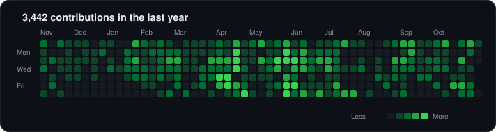
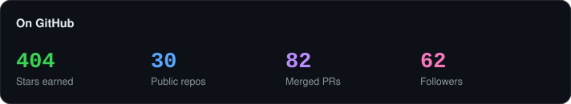

<p align="center">
  
</p>

<br>

<p align="center">
  <a href="https://x.com/madebyoutside"></a>
  <a href="https://kheljatra.com"></a>
  <a href="https://github.com/sajxraj?tab=repositories"></a>
</p>

## Now

- 🚀 Building **[kheljatra](https://kheljatra.com)** — live football & cricket prediction game. Laravel 11 · Inertia · Vue 3 · Postgres.
- 🛠️ Everything at **[@madebyoutside](https://x.com/madebyoutside)** — full-stack product work, mostly Laravel and TypeScript.
- 🤖 LLM tooling side quests: **open-civic** (AI assistant for Nepal government services) and **ragtopus** (RAG framework, Node + Postgres).
- 📍 Kathmandu, Nepal.

## Featured

| Project | What it is | Stack | Stars |
|---|---|---|---|
| **[kheljatra](https://github.com/sajxraj/kheljatra)** · [live ↗](https://kheljatra.com) | Real-time football & cricket prediction game | Laravel 11 · Inertia · Vue 3 · Postgres | — |
| **[InventoryManagementSystem](https://github.com/sajxraj/InventoryManagementSystem)** | Desktop inventory tracker (products, suppliers, sales) — most-starred build | Java · Swing | ⭐ 344 |
| **[OfficeManagementSystem](https://github.com/sajxraj/OfficeManagementSystem)** | Attendance, tasks, leave & complaint management | PHP · MySQL | ⭐ 40 |
| **[clocktopus](https://github.com/sajxraj/clocktopus)** | Multi-platform time logging for Clockify & Jira | TypeScript | ⭐ 4 |
| **[laravel-docker](https://github.com/sajxraj/laravel-docker)** | Opinionated PHP + nginx + MySQL dev environment | Docker | ⭐ 4 |
| **[open-civic](https://github.com/sajxraj/open-civic)** | AI assistant for Nepal government services | TypeScript · LLM | ⭐ 3 |

## Journey

```text
2014  joined GitHub            2020  small tools & Chrome extensions
2016  Laravel — still the one  2021  TypeScript (Nest, Node) all-in
2017  deploy automation:       2025  LLMs & RAG (ragtopus, open-civic)
      Capistrano · Ansible     2026  kheljatra → production
2018  Vue & SPAs
2019  Dockerized every setup
```

## Activity

<p align="center">
  &nbsp;
</p>

<details>
<summary>Elsewhere & more</summary>

<br>

- [X / Twitter — @madebyoutside](https://x.com/madebyoutside)
- [kheljatra.com](https://kheljatra.com)
- Codewars:

<p align="center">
  
</p>

</details>

<br>

<p align="center">
  <sub>Stats cards regenerate nightly from the GitHub API — <code>scripts/generate_assets.py</code> · </sub>
</p>
